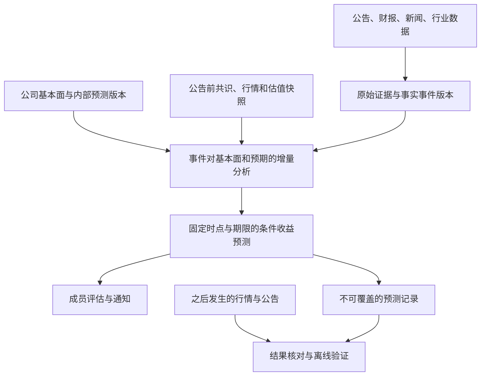

# 基本面、事件预期与股价预测结构设计

日期：2026-11-02；2026-11-03更新。阶段A的版本化研究基线、假设表及监控映射已在本地实现，并建立当前六家关注公司的初始归档，详见[本地研究基线](RESEARCH_BASELINE.md)。其中片仔癀最新财报仍待核；行情/共识、预期增量及收益预测阶段未实现，未启用新预测/推送或部署。

## 1. 目标和判断边界

将当前“检索新闻→模型判方向→成员通知”，扩展为“维护当时可知的公司状态→识别新增事实→比较事前预期→预测指定时点后的收益→保存并验证”。

输出必须同时保留三个层次，不能合并成一个永久有效的利好/利空标签：

1. **经营影响**：收入、利润、现金流或风险可能怎样变化，以及证据与条件。
2. **预期增量**：与本次新增事实公开前、同口径的共识/管理层指引比较；内部预测单列。
3. **走势预测**：从实际可用判断时点起，未来固定窗口的绝对收益和相对行业收益。概率和幅度只有在样本外验证、校准后才发布；此前仅提供条件方向或弃权。

建议首版将5个交易日设为主要评估窗口，1日和20日为辅助观察；这是待实施的产品选择，不声称已验证哪个窗口最好。首版先覆盖财报和业绩指引，再扩展订单、回购、监管、事故等不同事件模板。不能为不同事件临时挑选最有利的事后窗口。

股价未来上涨并不证明新闻有正面因果作用；公司经营受益也不保证绝对股价上涨。相对行业表现有助于控制部分共同变化，但仍不能识别所有因果混杂。

## 2. 三种时间与两种任务

- `fact_first_public_at`：每一新增事实版本首次可信公开时间。转载不改时点；正式财报中已预告的指标和新披露细节分别处理。
- `decision_at/available_at`：数据齐备、程序实际生成并持久化该预测的时间。预测不能从早于它的价格起算。数据异常或无法确定时点时不生成正式收益预测。
- `delivery_accepted_at`：消息接口实际接受时间，作为用户可获得消息的近似边界，不能当作客户端已读。若要评估用户可执行效果，采用不早于通知可用时点的可成交价格。

任务A在事件发生时识别变化并冻结初次判断；任务B在后续交易日收集结果和复评。B可以生成新版本，不能改写A，更不能把事后价格作为A的输入。

区分事件反应研究与可使用的预测：如果09:30公开、09:40生成判断，09:30～09:40的变化是已知反应；从09:40之后的窗口才检验剩余走势。若09:45才通知，另记录该延迟对用户可用预测的影响。当前5分钟扫描、别名15分钟补查及普通半小时摘要，不能直接承诺公告瞬间的时效优势。

## 3. 处理结构

### 3.1 来源与证据层

保留现有新闻适配器，逐源增加有权使用的公告、财报、公司IR、行业变量、行情、共识和公司行为数据。每源返回成功/部分覆盖/失败、时间与版本，不能把接口失败当作没有风险。

保存原始证据引用、证券标识、公开时间、抓取时间、语言、财务期间、单位、币种和会计口径。修订及更正追加版本，不以最新数值覆盖历史。研究留存与通知缓存分开管理；15天热数据清理不能删除用于基本面状态和预测复现的记录。留存范围与期限须与选定来源的实际能力和许可一致。

### 3.2 公司基本面与研究状态

公司身份与上市证券身份分开：同公司不同上市地的币种、价格、流通股和交易日历不能混用。

建议建立长期、可追溯的`CompanyState`：主营业务及产品、客户/供应链关系、季度财务、收入/毛利率驱动、资本开支、库存、现金流、负债、主要风险、待验证经营假设。行业模板先做有限范围，不使用一个增长公式覆盖所有公司。

内部预测单列为`ResearchForecast`，记录收入/利润/现金流情景、计算依据、关键条件、版本和失效时间。模型可以从材料提取有证据的事实及候选解释；算数、期间转换和口径校验由程序执行。没有数据的内部预测不能冒充市场共识。

维护三套不同对象：已披露事实、内部研究预测、外部市场共识；三者不可互相覆盖。定期维护公司状态，有重大事件时增量更新，并在数据过期时标记需复核。

维护财报/指引等可预知事件日历，提前列出待验证指标、已有预告和可能改变判断的条件；预期快照需在消息出现前就持续积累，不能等消息落地后让模型回忆市场此前如何预期。突发事件使用其公开前最后一个合格状态，缺失时明确降级。

#### 新增关注时的研究底座（2026-11-03补充，研究基线已本地实现）

新增股票或方向后，建议建立独立的研究准备任务，与成员订阅是否成功分开。研究状态可为采集、待核实、可用或需更新；不得用初始化失败删除订阅、重置生效时间/seen或重发历史新闻。已有证据支持的重大事实提醒可以继续，缺少研究/市场数据时不生成无依据的价格预测。

先记录关注理由、研究期限与待验证问题；长期竞争优势不能自动成为未来几日上涨的理由。公司研究底座与具体上市证券的价格、币种、股本/稀释和权利关系分别管理。

个股底座至少包括以下十部分：

| 部分 | 要回答的问题与应保存的结果 |
| --- | --- |
| 商业模式 | 谁付钱、为什么购买、公司赚哪个环节的钱；分产品/业务/地区的收入和利润来源，定价/回款方式 |
| 行业、价值链与周期 | 上下游、竞争与替代、供需/库存/扩产周期；增长来自行业还是公司份额；利润池在哪里 |
| 竞争优势 | 成本、技术、品牌、渠道、客户切换成本或规模优势的证据；与同行的持续差异、优势被削弱的条件 |
| 盈利驱动 | 按行业选择销量/售价/产品结构/成本/利用率等少数主要变量，建立收入→利润→现金流的传导关系与敏感性 |
| 财务质量与生存能力 | 多期财务趋势、扣非/一次性项目、利润现金转换、应收/库存、资本开支、可用现金/债务期限和融资需求 |
| 管理层、治理与资本配置 | 过往指引兑现、关联交易、股权/激励、融资稀释、并购/扩产投资回报、分红回购目的和实际执行 |
| 内部情景与外部预期 | 基准/乐观/悲观经营情景及依据；市场共识/指引单列，保留发布时间、期间、覆盖分歧和未知项 |
| 估值与价格要求 | 适用的估值方法及可比对象，当前价格隐含何种增长/利润率；假设敏感性，避免周期峰值利润造成的低倍数错觉 |
| 风险、反向证据与证伪 | 需求、竞争、技术替代、监管、客户/供应商集中、财务等主要风险；什么观测会迫使下调/推翻原假设 |
| 催化与跟踪计划 | 财报/产品/订单/政策执行等日历、领先经营指标、触发更新条件及可用来源；区分宣布、执行与经营兑现 |

身份和证据是上述研究的前置项：确认公司与上市证券/市场、最新可得报告期、会计与币种口径。公司披露、第三方核验、模型推断、内部预测与未知内容必须可辨；缺少披露的业务占比不能由模型补成已知事实。

完成初始研究后，建议形成三项可复用结果：

1. **研究基线**：上述内容的有来源、带截止日期的版本，结论标明事实/假设/未知。
2. **关键假设表**：少量核心经营假设、预期范围或方向、观察窗口、支持证据、反证与需修订条件；不强迫在数据缺失时填写数字。
3. **监控映射表**：事件→受影响业务/指标→经营与估值传导→与已有预期比较→需要核实的材料。例如产品涨价需检查受益产品占比、实际成交价和成本变化；扩产需检查需求、资本开支、投产时点、利用率和供给竞争。

方向/主题的研究底座另有要求，不能只复制公司模板：先定义边界、包含/不包含的产品/技术/地域；识别终端付费需求及价值链利润池；绘制竞争/替代技术路线和商业化阶段；跟踪供需/库存/资本开支/政策执行；建立受益、承压及间接关联环节的映射。相关上市公司的业务收入、订单或研发阶段分别标记，概念关联不等于可兑现利润。代表公司/指数用于研究和基准说明，不自动变为成员新增订阅。

研究按变化速度更新：商业模式/优势在重大变化时深度复核，财务/经营情景在新财报指引时更新，行业领先指标按来源频率刷新，价格与预期在每次事件判断时使用最新合格快照。不得以一份“首次报告已完成”作为长期不再更新的理由。

最低可用门槛是身份与范围清楚、主要业务/驱动有证据、最新可得财务期可核对、核心假设与风险/反证明确、跟踪来源可用；不要求所有字段齐全，也不把字数或统一总分当就绪标准。缺少合格共识/行情时，基础研究可用与收益预测可用分别标记。

就绪能力分别检查可跟踪、可做基本面判断、可比较预期、可输出经过验证的预测，不以一个完成按钮混为一谈。资料的下次复核点按商业模式、季度情景和行情等变化速度设置，不给全部研究内容套同一失效时间。

### 3.3 事件与预期差

从文章身份提升为事件身份：公司/证券、事件类型、公告编号或报告期，以及事实版本；保留全部来源。相似标题只可用于候选聚类，不能自动证明同一事件。每个实质新增事实有自己的可信公开时间。

事件处理先冻结`before_state`、公告前预期及当时市场快照，再产生`after_state`和变化向量。比较本季实际值、未来指引及关键业务指标，保留正反证据，不把多个矛盾指标平均成“利好分”。

预期记录保留`available_at/as_of/ingested_at`、指标、期间、口径、覆盖人数、分歧和来源。只使用当时可得快照；不能拿今天修订后的共识回填过去。无合格预期时返回未知，不能从股价前期上涨猜造共识。事前重大程度按当时的潜在经营影响确定，不能事后按涨跌幅挑选重大事件。

#### 新闻筛选与已有信息更新（2026-11-03补充，未实施）

将“值得采集”“改变研究状态”“值得再次通知”分成三个决策；一篇新文章不自动代表新经营事实。建议流水线如下：

1. **保存证据与时间**：保留来源观察、公开/取得时间和材料范围，识别转载、原始披露与独立核验。未知/冲突时间待核实，不用当前抓取时间给旧闻续期。
2. **定位主体与作用路径**：关联具体公司/证券、产品/业务或主题环节。用既有价值链与驱动映射核对受益/承压关系，关键词命中只产生候选。
3. **结构化事实**：抽取主体、动作/指标、期间、口径、单位币种、数值或状态、适用条件及原文位置；区分已发生事实、管理层计划、传闻、预测和观点。
4. **归入事件并计算差异**：优先公告编号、报告期/经营事项与规范事实，不使用完整标题或自由模型措辞作为业务身份。语义相似只产生归并候选；两次回购、不同订单/期间不能误合。
5. **冻结比较基线**：读取新增事实公开前的研究假设、内部预测/外部共识；事件判断时的价格上下文另存。不能先用新材料更新预测再拿新预测当原先预期。
6. **更新受影响内容**：只沿事实→业务驱动→盈利/现金流/风险→估值/走势的有证据路径重算，保存before/after、变更原因和所有来源；未受影响内容不因一篇报道重建。
7. **单独评估通知**：与该成员上次实际通知的事实和结论比较，仅首次重要事实、实质进展/更正、重要确认或推翻此前判断等产生提醒资格；再应用原订阅、时效和频控。
8. **后续复核**：未澄清争议和未兑现假设保留待办；已产生预测按原窗口核对结果，不能事后改写原判断。

事实差异应有以下独立类型：

| 差异 | 已有信息如何更新 | 默认通知行为 |
| --- | --- | --- |
| 重复事实/转载 | 关联新出处，不新增经营状态或重建预测 | 不提醒 |
| 新增独立证据 | 更新确认状态及证据链；转载不算独立证据 | 通常不提醒；由未证实转为重要官方确认时另评估 |
| 同事件新增指标/细节 | 并入同事件，如财报新增毛利率、现金流、环比数据 | 只有改变重要判断时提醒增量 |
| 更正、撤销、计划转实施 | 追加事实版本及替代关系，保留旧记录和已通知证据 | 重大更正/进展可提醒，明确旧值、新值及影响 |
| 同口径矛盾 | 标记争议，查原始披露；不平均、不自动采用更新或更乐观数值 | 重要且需纠正原提醒时明确不确定性 |
| 新观点/研报解释 | 作为研究观点/假设与反证保存，不写成已实现事实 | 通常不单独提醒，必要时触发研究复核 |
| 行情变化 | 更新市场上下文及复评记录，不改公司经营事实 | 不因每次价格快照自动重发新闻 |

用“组织/成员＋业务事件＋实质变化ID”管理通知幂等，实质变化ID来自可核对的事实差异及其版本，不来自文章标题、模型措辞或重跑时间。研究状态可以多次更新而不发送新通知。成员上次已通知状态与研究最新状态分开，尚未发送的消息可以受控合并；已接受任何分段后冻结原文，有必要的更正通过引用原事件的新提醒表达。

已过新闻提醒期限但后被发现的经营事实仍可以补入研究档案，并保留首次披露/取得时间，不能伪装为实时新事件。新共识和新价格只更新对应快照，不覆盖历史预期、不清理seen、不修改订阅生效时间，也不自动延长原通知期限。

优先级建议：可单独先修复业务事件身份、事实差异和成员通知账本，再建设完整基本面/预测模型；去重不依赖已训练出可靠收益预测器。

### 3.4 行情、定价背景与收益预测

将预期差、对未来盈利预测的修订、估值情景、市场/行业状态、事件前相对表现、截至判断时点已发生的反应、波动与流动性等组成版本化特征。

先建立可解释规则/简单统计基线，验证后再决定是否采用更复杂模型。LLM不作为唯一收益预测器，其自报confidence不等于经校准的上涨概率。模型参数、特征与概率校准方法必须有训练/验证记录和版本。

保留`absolute_return_forecast`与`relative_return_forecast`；预测方向、幅度区间和概率必须注明窗口。材料不完整、事件混杂严重、数据过期或模型超出适用范围时允许弃权，并保存原因。缺少走势预测不能阻断已有证据支持的重大经营风险提醒。

反向估值用于解释现价隐含的增长要求；不将“已被预期”“已有价格反应”和“估值充分”压成一个priced_in布尔值或无依据百分比。模型估算的新闻增量也不当作可观测的新闻单独因果效应。

### 3.5 不可覆盖记录与验证

建议新增逻辑实体，物理表设计在实施时确定：

- `fundamental_observations/company_state_versions/research_forecasts`
- `event_versions/event_facts/evidence_links`
- `consensus_snapshots/market_context_snapshots`
- `assessment_versions/predictions/prediction_outcomes/model_versions`

预测记录包括证券、事件版本、before/after状态、全部输入快照引用、`decision_at`、期限、基准、特征版本、预测版本、弃权原因及通知时点。后续实际收益放入独立结果表。更正预测追加记录，不能事后修改原预测。

关键研究输入应可以重放，不依赖只存15天的文章热缓存；对敏感成员信息和受限材料分别按实际权限隔离，不把研究归档变成凭证/完整敏感消息日志。

## 4. 现有程序怎样调整

| 现有位置 | 保留能力 | 调整内容 |
| --- | --- | --- |
| `news.py/query_policy.py` | 可注入来源、检索策略 | 扩展来源协议与覆盖状态，新闻不承担财报/行情/共识全部职责 |
| `quality.py` | 原始观察、修订、时间校验、保守去重 | 增加公告/报告期事实身份与事件链；不把已处理或过期解释为已定价 |
| `analyzer.py` | 受约束JSON与独立目标分析 | 拆成事实提取/经营分析，接入冻结公司状态；收益预测由独立模块负责 |
| `subscription_scan.py` | 任务认领、预算、成员一致性 | 拆分采集、事件更新、分析、通知评估；公司级研究不按成员重复计算 |
| `subscription_monitor.py` | 个人关注及方向/等级过滤 | 经营标签、预期差、走势期限分别配置；动态缓存包含状态及快照版本 |
| `analysis_jobs.py/worker.py` | 持久恢复、唯一后台入口 | 增加基本面刷新、事件分析、预测复评、结果采集；有独立优先级/预算，避免研究刷新堵住重大事件与管理回执 |
| `notifications.py/delivery.py` | 候选/outbox/隔离/分段检查点 | 展示经营影响和期限走势；防止复评/价格刷新重复提醒，区分生成和发送时点 |
| `db.py` | SQLite与可迁移schema、短事务 | 增加研究实体及保留策略，保持旧历史/基线/已投递事实；不把schema4直接改写为不兼容结构 |

继续保留Python3.12、唯一worker、HTTP只处理请求、短事务和远程请求期间不持写锁。公开公司研究可按同一需求复用，私有成员背景继续隔离；成员订阅决定是否接收，不能决定公司历史事实是否存在。新增调度和来源默认不因部署自动启用，更不隐含真实模型调用、付费采购或真实投递授权。

本地推理与线上调度保持轻量；训练和大规模历史回放离线进行。首版日频/事件级研究优先，不直接引入全市场分钟级流式架构或分布式服务。

## 5. 如何证明预测有增量

设定并冻结任务定义，按时间滚动训练/验证/测试；同一事件的转载、同一结果窗口和高度相关的簇不能泄漏到不同集合。保留未成功、弃权和未推送记录，避免只统计发出去的成功案例。历史样本不能只包含今天仍受关注或存续的成功公司。

至少比较三个在相同时点、相同股票范围评估的模型：市场/行业/历史行情基线；加入基本面；再加入新闻与预期差。检验完整模型是否带来稳定样本外增量，而非仅比随机猜测好。

分别度量事实提取与事件归并正确性、预期差口径正确性，以及收益方向、幅度误差、概率校准、预测覆盖率/弃权率。概率须有足够样本校准；指标与阈值在测试前确定。若讨论交易效果，另计处理/投递时延、成交约束、滑点、费用及风险，预测命中率不能替代净收益。

回测后进行只记录不推送的实时影子运行，冻结每次预测，再按到期窗口核对。新版模型有独立版本和上线门槛，不能把看过的测试期继续称为未见样本。LLM可能记得历史事件结局，限制其为证据提取角色并做前瞻验证，不能只凭历史问答回测宣称有效。

软件离线测试覆盖时间边界、同事件版本、口径/单位、未知数据、交易日历/复权/停牌、幂等/迁移及成员隔离。测试通过仅说明程序按规则工作，不证明金融预测优势。

## 6. 困难与取舍

1. **数据比提示词更难**：可靠的公告前历史共识、修订财报、行业价格及精确时点覆盖未接入；小公司覆盖可能稀疏，数据成本和用途范围须逐源确认。
2. **市场预期不可直接观测**：卖方共识不等于所有资金的预期；“已定价部分”和某新闻的单独影响不具唯一可识别答案。
3. **公司模型不能通用套用**：不同产品/客户/成本结构决定涨价、扩产、汇率等事件究竟受益或受损，需要行业模板及持续维护。
4. **速度与目标不匹配**：部分价格反应先于系统发现或通知，盘后公告也可能在下一可交易价格中反映；必须验证剩余走势，不能认领已发生的行情。
5. **重大事件样本少、相关性高**：少量关注股票的几个季度不足证明稳健预测力；可能需要更广历史样本训练、再对关注股票推理，并检验跨行业/市场环境的适用性。
6. **预测关系会变化**：行业周期、估值、利率、政策和流动性改变后，旧规律可能失效；复杂模型增加过拟合和维护成本，需保留回退与弃权。

## 7. 实施顺序和阶段门槛

| 阶段 | 可交付能力 | 进入下一阶段的门槛 |
| --- | --- | --- |
| A：研究底座 | 少量公司、有限事件类型的证据/基本面版本、事件归并与历史快照 | 来源及口径可靠，原时点可重放，重复/更正不混淆 |
| B：预期增量分析 | 事前预期对照、状态before/after变化、条件解释 | 无未来信息，未知数据降级，人工复核通过；尚不宣称价格预测 |
| C：预测实验 | 固定窗口规则/统计基线、预测账本、滚动历史检验和实时影子观察 | 样本外增量、校准、覆盖及延迟表现达到预先约定门槛 |
| D：经过验证的提醒 | 展示期限、条件、反向风险与模型版本 | 默认开关关闭；真实订阅/投递沿既有授权边界单独启用 |

不预先承诺预测准确率、收益率、全部事件覆盖或固定采购预算。本设计不含自动交易。

## 8. 依据及未验证项

- 财报期收益与实际业绩、未来指引预期差：[Hand等，2021/2022](https://link.springer.com/article/10.1007/s11142-021-09597-6)。
- 保证使用当时可得预测的历史快照：[FactSet PIT说明](https://insight.factset.com/resources/at-a-glance-factset-estimates-point-in-time-consensus?hs_amp=true)。
- 按时间滚动回测与生存/前视偏差：[CFA Institute，Backtesting & Simulation](https://www.cfainstitute.org/insights/professional-learning/refresher-readings/2026/backtesting-and-simulation)。
- 投资模型验证的边界：[CFA Institute Research Foundation，2024](https://rpc.cfainstitute.org/research/foundation/2024/investment-model-validation)。
- LLM历史回测可能含结局记忆：[Glasserman/Lin，2023工作论文](https://arxiv.org/abs/2309.17322)。

尚未取得或购买新数据、建立财务模型、训练收益预测器、执行金融效果回测或前瞻影子运行。本轮仅审阅代码和编写设计，不修改业务代码、运行配置、生产数据库或订阅。
